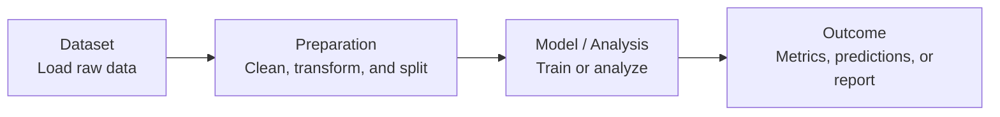

# Deep Learning

**Learning archive** · A neural-network learning project for customer churn prediction.

## Overview

A neural-network learning project for customer churn prediction.

## Technology Stack

- `Python`
- `Jupyter Notebook`

## How the Repository Works

| Stage | Responsibility |
|---|---|
| **Dataset** | Load raw data |
| **Preparation** | Clean, transform, and split |
| **Model / Analysis** | Train or analyze |
| **Outcome** | Metrics, predictions, or report |

## Concepts Covered

- Neural networks
- Feature preprocessing
- Model training
- Binary classification
- Evaluation metrics

## Repository Map

- `Churn_Modelling_ANN.ipynb`

## Recruiter Summary

This repository shows hands-on practice, iterative learning, and problem-solving across the technologies listed above. It is most useful as evidence of foundational growth and experimentation rather than as a production release.

---

Documentation is concise and project-focused; source code was not modified.
